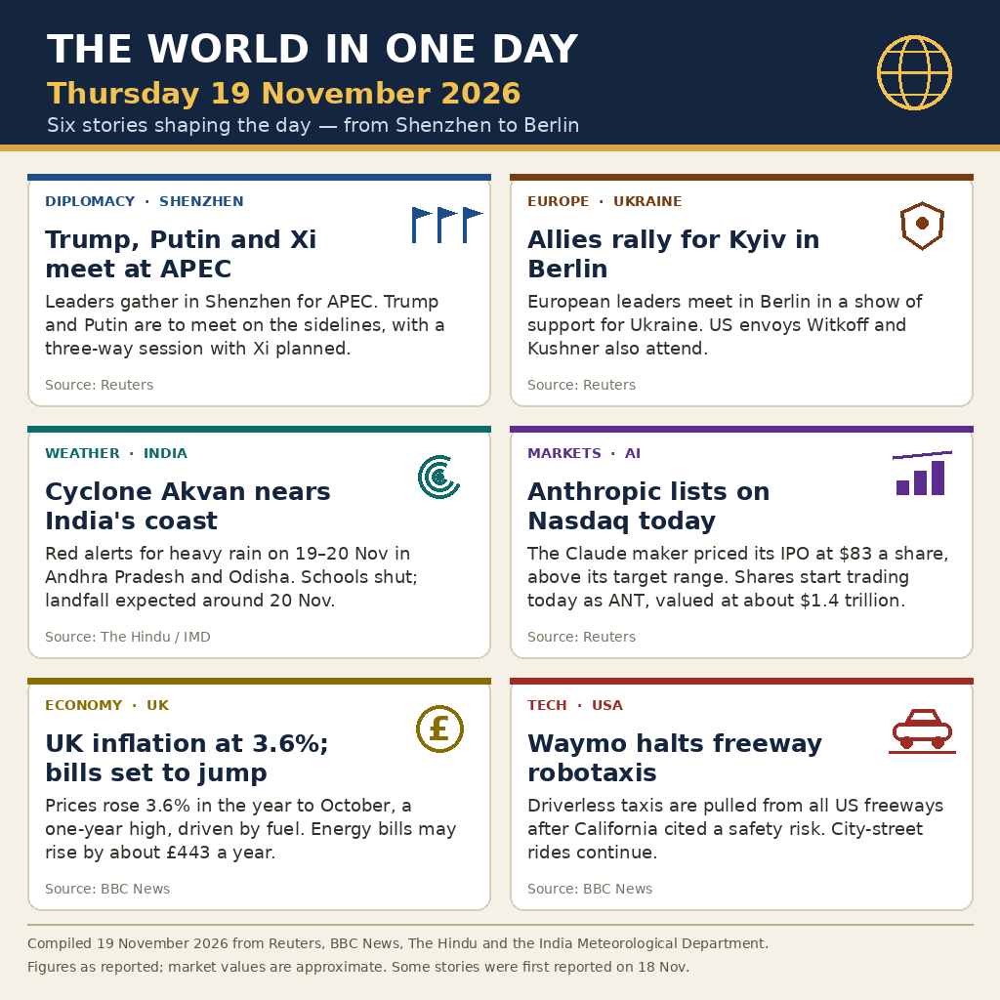

[](https://make.fun/bounty/news-image-20261119?utm_source=github&utm_medium=readme&utm_campaign=news-image-20261119)
[](https://make.fun/bounty/news-image-20261119/leaderboard?utm_source=github&utm_medium=readme&utm_campaign=news-image-20261119)
[](https://make.fun/bounty/news-image-20261119?utm_source=github&utm_medium=readme&utm_campaign=news-image-20261119)

# The World in One Day — Thursday 19 November 2026

One 1024×1024 image summing up the world news of Thursday 19 November 2026: six stories, from Shenzhen to Berlin.



## The six stories

1. **Trump, Putin and Xi meet at APEC** — Leaders gather in Shenzhen for the APEC summit. Trump and Putin are to meet on the sidelines, with a three-way session with Xi planned. ([Reuters](https://www.reuters.com/world/china/putin-trump-meet-apec-summit-no-full-scale-talks-planned-kremlin-says-2026-11-18/))
2. **Allies rally for Kyiv in Berlin** — European leaders meet in Berlin in a show of support for Ukraine. US envoys Witkoff and Kushner also attend. ([Reuters](https://www.reuters.com/world/china/ukraines-european-allies-meet-berlin-show-support-2026-11-19/))
3. **Cyclone Akvan nears India's coast** — Red alerts for heavy rain on 19–20 Nov in Andhra Pradesh and Odisha. Schools shut; landfall expected around 20 Nov. ([The Hindu](https://www.thehindu.com/news/national/andhra-pradesh/uncertainty-over-path-of-cyclone-akvan-north-ap-and-south-odisha-put-on-alert-now/article71716887.ece))
4. **Anthropic lists on Nasdaq today** — The Claude maker priced its IPO at $83 a share, above its target range. Shares start trading today as ANT, valued at about $1.4 trillion. ([Reuters](https://www.reuters.com/legal/transactional/anthropic-prices-blockbuster-ipo-83-share-source-says-2026-11-18/))
5. **UK inflation at 3.6%; bills set to jump** — Prices rose 3.6% in the year to October, a one-year high, driven by fuel. Energy bills may rise by about £443 a year. ([BBC News](https://www.worldrightnowlive.com/story/petrol-and-diesel-prices-push-inflation-to-highest-in-a-year))
6. **Waymo halts freeway robotaxis** — Driverless taxis are pulled from all US freeways after California cited a safety risk. City-street rides continue. ([BBC News](https://www.bbc.com/news/articles/cmy86pp336qlo))

Figures are as reported; market values are approximate. Some stories were first reported on 18 Nov and are shown as reported, without a 19 Nov date claim.

## How it works

- `draw_infographic.py` (Pillow, build time only) draws `entry.png` from scratch: a header naming Thursday 19 November 2026, six story cards with hand-drawn geometric icons, and a sources footer.
- `main.py` (Python 3.13, standard library only, no network) copies the bundled `entry.png` to `$MAKEFUN_OUTPUT_DIR/entry.png`, byte for byte, on every run.

## Verify locally

```sh
python3 draw_infographic.py          # rebuild entry.png (1024x1024, <= 1 MiB)
MAKEFUN_OUTPUT_DIR=/tmp/out1 python3 main.py
MAKEFUN_OUTPUT_DIR=/tmp/out2 python3 main.py
sha256sum entry.png /tmp/out1/entry.png /tmp/out2/entry.png   # all three identical
```

## License

MIT — see [LICENSE](LICENSE).
